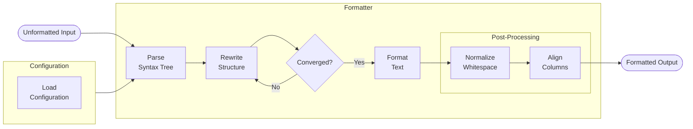

# Architecture                                                   {#architecture}

@tableofcontents

slang-format is an experimental SystemVerilog code formatter based on [slang][1]
and heavily inspired by [clang-format][2]. Verilog-2005 (IEEE 1364-2005) is
fully supported as a subset of the SystemVerilog language. All major operating
systems are supported, including Linux, macOS, and Windows.

## Dependencies

- [slang][1] -- SystemVerilog compilation, elaboration, and analysis
- [yaml-cpp][3] -- Parses configuration files written in YAML
- [GoogleTest][4] -- Testing and mocking framework

## Directory Structure

```txt
slang-format/
├── cmake/                  # CMake configuration
│   └── Modules/            # CMake modules
├── docs/                   # Project documentation
├── examples/<example>/     # Example programs
│   └── source/             # Example source code
├── external/               # External data
├── include/slang/
│   ├── format/             # Public library headers
│   │   └── styles/         # Predefined formatting styles
│   └── util/               # Shared utility headers
├── source/                 # Library source code
├── tests/                  # Library unit tests
└── tools/<tool>/           # Command-line tools
    ├── source/             # Tool source code
    └── tests/              # Tool unit tests
        └── fixtures/       # CTest scripts
```

## Formatting Flow



## Architectural Decisions

### Organization

#### Library and Tool Separation

The project is organized into a core formatting library and a CLI tool. The
library contains the formatting engine, alignment passes, rewriter, and public
headers under `include/slang/format/`. This separation allows other projects to
consume the formatting engine as a library without pulling in CLI infrastructure
or dependencies.

#### Public Headers and Symbol Visibility

`include/slang/format/` holds the headers intended for the library API, which
are included with quotes and a path relative to `include/` so they are visually
distinct from upstream headers.

The library supports building as both static and shared. It sets default symbol
visibility to hidden and marks public symbols with `SLANG_FORMAT_EXPORT` via the
`slang/format/Export.h` header. This ensures only intentionally exported symbols
appear in the shared library's dynamic symbol table.

### Configuration

#### Configuration Search

`loadConfig()` implements the directory-hierarchy configuration search described
in [Usage](@ref usage). The strategy mirrors clang-format's `.clang-format`
lookup, allowing per-project configuration without explicit path arguments.

#### Predefined Styles

Predefined styles live in `include/slang/format/styles/<Name>.h`, inside the
`slang::format` namespace. Each header exposes `inline Style get<Name>Style()`
returning an aggregate built with designated initializers that lists every
field.

`Style.h` has no default member initializers. Tests obtain defaults from
`getDefaultStyle()`. Because the fields have no initializers, a missing field in
any style header as an error under `-Wextra`, which keeps style headers complete
as options are added.

`parseConfig()` resolves `BasedOnStyle` first through a `constexpr` name table
in `ConfigFile.cpp` that maps names to the style header functions. See [Style
Options](@ref style-options) for the user-facing behavior. The table is the
single registration point and is intended to back a future `--style` option.

#### Configuration Dump

The `--dump-config` option serializes the resolved style to stdout. When a
shared struct contains fields that are unused by a particular option, those
fields are not emitted.

#### Ignore File Lookup

The ignore file loader walks upward from the directory containing the source
file, mirroring the configuration file lookup. Ignore files are not merged
across directory levels; a lower-level file voids any higher-level ones. See
[Usage](@ref usage) for pattern syntax.

### Rewriting

#### Separate Structural and Formatting Passes

Structural AST changes are handled by a pipeline of five rewrite passes that run
in sequence before formatting. Each pass consumes and produces a syntax tree:

1. `begin`/`end` insertion -- wraps statements bodies in blocks.
2. Parenthesis insertion -- inserts parentheses around constructs.
3. Event separator normalization -- normalizes event expression separators.
4. Packed dimension bounds normalization -- reorders packed dimension bounds.
5. Unpacked dimension bounds normalization -- reorders unpacked dimension bounds.

The first three passes iterate to convergence (see below); the last two run a
single transform. A read-only formatting pass then emits output directly from
the rewritten tree, handling indentation, break insertion, empty line limiting,
and pragma handling.

This separation keeps each concern in its natural abstraction: the rewrite
passes operate on tree structure, the formatting pass operates on token
emission.

#### Iterative Rewriting

slang's syntax rewriter imposes a constraint: it applies all registered changes
atomically, and replaced nodes are not re-visited. This means transformations
that affect nested constructs (e.g. an `if` body nested inside an `always` body)
cannot complete in a single pass.

Three of the five rewrite passes -- begin/end insertion, parenthesis insertion,
and event separator normalization -- handle this by iterating: each pass
transforms the outermost affected nodes, and subsequent iterations handle newly
exposed inner ones. The loop terminates when a pass produces no changes. Typical
code converges in 1-2 iterations; worst case is `O(nesting depth)`. The
remaining two passes (dimension bounds normalization) operate on leaf-level
syntax and do not require iteration.

### Formatting

#### Single-Pass Formatting

The formatting pass performs a single traversal of the already-rewritten tree.
Carrying formatting state across the walk is straightforward to reason about,
and the single-pass constraint keeps the implementation linear and predictable.

The pass is implemented by a single `FormatPrinter` class declared in
`FormatPrinter.h`. Its handlers are defined across the other `Format*.cpp` files
grouped by SystemVerilog construct (e.g. class, declaration, expression, member,
port list, and statement). `FormatPrinter.h` serves as the header for handler
files and for `FormatPrinter.cpp`, which contains the core formatting helpers.

#### Whitespace Normalization

The formatter strips all trivial whitespace within a line, then re-inserts
spaces only where required. Whitespace whose removal would cause adjacent tokens
to merge is reduced to one space. All other inter-token whitespace is suppressed
by default. Options that need to preserve existing formatting verbatim must
define an explicit `Preserve` value; boolean options do not offer a pass-through
mode. Line breaks (`EndOfLine` trivia) are unaffected by whitespace
normalization.

#### Statement Breaks and Block Break Style

The `OneStatementPerLine` option inserts line breaks between same-line
statements during the formatting pass. The `BlockBreakStyle::OnlyMultiline`
value for `BreakAfterAlways` and related options inspects source trivia to
determine whether a block spans multiple lines, and only inserts a break when it
does. These two features interact because the multiline check runs before
statement breaks are inserted. The `shouldBreakAfterProcedural()` and
`shouldBreakBeforeProcedural()` helpers resolve this by accepting the
`OneStatementPerLine` state: when enabled and the block contains more than one
item, the block is treated as multiline regardless of source trivia. Conditional
statements with else clauses are also treated as inherently multiline, because
the formatting pass unconditionally breaks between the if body and the else
keyword.

#### Column-Limit-Aware Layout

Two features consume `ColumnLimit` for layout decisions during the formatting
pass: compaction of control statement bodies and wrapping of argument lists.

When `CompactControlStatements` is enabled, the formatter suppresses the
statement break before a bare if/else body if the compacted line fits within
`ColumnLimit`. The compaction check uses a `flatWidth()` helper that walks all
tokens in the body subtree to estimate the flattened width; if any token carries
comment or newline trivia, compaction is blocked for that branch.

`AlignAfterOpenParen` wraps parenthesized argument lists that exceed the column
limit. A shared `visitArgumentList()` helper handles all `ArgumentListSyntax`
nodes. The `Align` mode uses an absolute-column indentation mode
(`parenAlignColumn()`) that overrides normal indentation and emits spaces to the
column immediately after the opening parenthesis, producing Verible-style
alignment. The `BinPackArguments` option controls whether wrapped arguments are
greedy-filled or placed one per line.

The formatter therefore has four indentation modes: primary, continuation,
port-item, and the absolute-column mode used by `Align`.

### Post-Processing

#### Alignment

`Align.cpp` drives the alignment passes implemented in the `Align*.cpp` files
and exposes them to the formatter through `applyAlignment()`. Alignment requires
knowledge of multiple adjacent lines to compute the maximum column width, which
is incompatible with the single-pass tree walk where each token is emitted
independently. The tree walk populates a per-line `LineMetadata` record as a
side channel alongside the formatted output. Each record carries the line's
syntactic kind and AST nesting depth. The alignment passes consume this metadata
for line classification and group formation. Position extraction for column
alignment is still performed by text scanning, since preceding alignment passes
may insert padding that shifts column positions from their original values.

`applyAlignConsecutive()` drives group formation while delegating break, start,
and alignment decisions to per-alignment-type callbacks passed as
`function_ref`. It runs six passes in order: packed dimensions, declarations,
timing controls, assignments (which also cover dist items), port connections,
and trailing comments. Assignment and port connection alignment groups are
scoped by AST depth to prevent cross-alignment across block boundaries.

#### Alignment Inference

When `InferFromSource` is enabled for an alignment style, the formatter captures
per-token spacing data during the tree walk. The alignment engine uses this data
to infer whether the source was already aligned: if the maximum excess spacing
(source minus output) across a group is small, alignment is suppressed to
preserve the author's flush-left intent; if the excess is large, the engine
aligns to reproduce the author's aligned layout. The `MinPadding` option
provides a floor guarantee: groups with alignment displacement at or below
`MinPadding` are always aligned regardless of inference, ensuring small groups
receive consistent treatment.

#### Range Spacing Normalization

When `RangeSpacing` is set to `MatchSource`, the formatting pass preserves exact
source whitespace around range colons. If packed dimension inference is also
enabled, a normalization pass runs before the packed dimension alignment pass,
reducing multi-space ranges back to single-space for lines not adjacent to port
list groups with excess spacing.

#### Format-Off Regex

The `OneLineFormatOffRegex` option strips indentation from lines matching a
regex. The formatter applies this as a post-processing pass over the
already-formatted string, because the regex needs the final rendered text that
only exists after the tree walk.

### Testing

#### Unit Tests

Unit tests live in `tests/`, one file per translation unit, written with
[GoogleTest][4]. Expected output uses `dedent()` from
`include/slang/util/Dedent.h` to align raw string literals with surrounding
code.

#### CTest Fixtures

Command-line features not covered by the unit test library are tested by CTest
scripts under `tools/format/tests/fixtures/`.

[1]: https://sv-lang.com/
[2]: https://clang.llvm.org/docs/ClangFormat.html
[3]: https://github.com/jbeder/yaml-cpp
[4]: https://github.com/google/googletest
