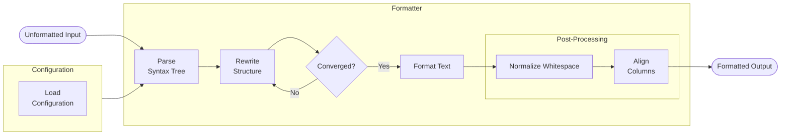

# Architecture

slang-format is an experimental SystemVerilog code formatter based on [slang][1]
and heavily inspired by [clang-format][2]. Verilog-2005 (IEEE 1364-2005) is
fully supported as a subset of the SystemVerilog language. All major operating
systems are supported, including Linux, macOS, and Windows.

## Dependencies

- [slang][1] - SystemVerilog compilation, elaboration, and analysis
- [yaml-cpp][3] - Parses configuration files written in YAML
- [GoogleTest][4] - Testing and mocking framework

## Directory Structure

```
slang-format/
├── include/slang/
│   ├── format/         # Public library headers
│   │   └── styles/     # Predefined styles
│   └── util/           # Shared utility headers
├── source/             # Library source code
├── tests/              # Library unit tests
└── tools/<tool>/       # Command-line tools
    ├── source/         # Tool source code
    └── tests/          # Tool unit tests
        └── fixtures/   # CTest scripts
```

## Formatting Flow



## Architectural Decisions

### Library and Tool

#### Library and Tool Separation

The project is organized into two tiers: a core formatting library
(`slang-format-lib`, aliased as `slang::format`) and a CLI tool
(`tools/format/`). The library contains the formatting engine, alignment passes,
rewriter, and public headers under `include/slang/format/`. Its only external
dependency is `slang::slang`. The tool contains CLI-specific code -
configuration file loading (`ConfigFile`), directory hierarchy file search
(`FileLoader`), ignore file handling (`IgnoreFile`), and the entry point
(`main.cpp`). The tool adds `yaml-cpp` as a dependency for YAML configuration
parsing. This separation allows other projects to consume the formatting engine
as a library without pulling in CLI infrastructure or the yaml-cpp dependency.

#### Public Headers and Symbol Visibility

`include/slang/format/` holds the headers intended for the library API:
`Format.h` (the public formatting interface), `Style.h` (types and documentation
only, depending on nothing but `<string>`), `VersionInfo.h` (library version
information), and `styles/`. They are included with quotes and a path relative
to `include/` (`"slang/format/Style.h"`) so they are visually distinct from
upstream `<slang/...>` headers.

The library supports building as both static and shared. It sets default symbol
visibility to hidden and marks public functions, classes, structs, and enum
classes with `SLANG_FORMAT_EXPORT`. CMake's `GenerateExportHeader` produces
`slang/format/Export.h` in the build tree, which defines `SLANG_FORMAT_EXPORT`
to the platform's export attribute for shared builds and to nothing for static
builds. Public headers include `Export.h` as their first local include. This
ensures only intentionally exported symbols appear in the shared library's
dynamic symbol table, reducing binary size and avoiding accidental ABI exposure.

### Configuration

#### Configuration Search

`loadConfig()` walks upward from the directory containing the source file until
it finds a `.slang-format` file or reaches the filesystem root, returning
default settings if none is found. This mirrors clang-format's `.clang-format`
lookup strategy, allowing per-project configuration without explicit path
arguments.

#### Predefined Styles

Predefined styles live in `include/slang/format/styles/<Name>.h`, one header per
style, inside the `slang::format` namespace. Each header exposes `inline Style
get<Name>Style()` returning an aggregate built with designated initializers that
lists every field, so a header is a complete specification readable without
`Style.h`. Style headers carry no member documentation; `Style.h` is the
canonical documentation for every option.

`Style.h` has no default member initializers. `Style{}` is value-initialized and
is not a usable style; code and tests obtain defaults from
`getDefaultStyle()`. Because the fields have no initializers, Clang 18
and later report a missing field in any style header as an error under
`-Wextra`, which keeps style headers complete as options are added.

`parseConfig()` resolves `BasedOnStyle` before any other key through a constexpr
name table in `ConfigFile.cpp` that maps names to the style header functions.
Matching is case-insensitive, as in clang-format. The base style replaces the
whole style and the remaining keys override it; an unknown name throws. The
table is the single registration point and is intended to back a future
`--style` option.

#### Configuration Dump

The `--dump-config` option serializes the resolved style to a YAML document on
stdout, matching the behavior of `clang-format --dump-config`. Fields are
emitted in alphabetical order, wrapped with `---` and `...` document markers.
`BasedOnStyle` is an input-only key and is never emitted, matching clang-format.
When a shared struct contains fields that are unused by a particular option,
those fields are not emitted.

#### Adding a Configuration Option

An option is mirrored in several places, all of which change together:

1. `Style.h` - Add the field with its documentation. The header carries
   documentation and types only, never values.
2. Every style header under `include/slang/format/styles/` - Add the value
   appropriate for that style. On Clang 18 and later a missing field is a
   compile error.
3. `ConfigFile.cpp` - Parse the key and insert it at the correct alphabetical
   position in `dumpConfig()`.
4. `ConfigFileTest.cpp` - Add a round-trip test.
5. `docs/style-options.md` - Document the option.

#### Ignore File Lookup

The ignore file loader walks upward from the directory containing the source
file until it finds a `.slang-format-ignore` file, mirroring the configuration
file lookup. Ignore files are not merged across directory levels; a lower-level
file voids any higher-level ones.

Patterns use glob syntax with `*` and `?` for single-segment matching. Both `**`
(bash globstar) and `...` (LRM 33.3.1 recursive directory search) are accepted
for recursive directory matching. The `!` prefix negates a pattern, with
last-match-wins semantics.

### Rewriting

#### Separate Structural and Formatting Passes

Structural AST changes (begin/end insertion) are handled by a dedicated rewrite
pass that produces a modified syntax tree before any formatting occurs. A
read-only formatting pass then emits output directly from the rewritten tree,
handling indentation, break insertion, empty line limiting, and pragma handling.

This separation keeps each concern in its natural abstraction: the rewrite pass
operates on tree structure, the formatting pass operates on token emission.

#### Iterative Rewriting

slang's syntax rewriter imposes a constraint: it applies all registered changes
atomically, and replaced nodes are not re-visited. This means wrapping nested
constructs (e.g., an `if` body nested inside an `always` body) cannot be done
in a single pass.

The begin/end insertion pass handles this by iterating: each pass wraps the
outermost bare statements, and subsequent passes handle newly exposed inner
ones. The loop terminates when a pass produces no changes. Typical code
converges in 1-2 iterations; worst case is O(nesting depth).

### Formatting

#### Single-Pass Formatting

The formatting pass performs a single traversal of the already-rewritten tree.
Carrying formatting state across the walk is straightforward to reason about,
and the single-pass constraint keeps the implementation linear and predictable.

The pass is implemented by a single `FormatPrinter` class declared in
`FormatPrinter.h`. Its handlers are defined across six `Format*.cpp` files
grouped by SystemVerilog construct (class, declaration, expression, member, port
list, statement). The CRTP visitor only needs the declarations in the class, and
handlers are independent, so splitting them avoids a single multi-thousand-line
translation unit. `FormatPrinter.h` serves as the header for all six handler
files and for `FormatPrinter.cpp`, which contains the core formatting helpers.

#### Whitespace Normalization

The formatter strips all trivial whitespace within a line, then re-inserts
spaces only where required. Whitespace whose removal would cause adjacent tokens
to merge is reduced to one space. All other inter-token whitespace is suppressed
by default. Options that need to preserve existing formatting verbatim must
define an explicit `Preserve` value; boolean options do not offer a pass-through
mode. Line breaks (`EndOfLine` trivia) are unaffected by whitespace
normalization.

#### Statement Breaks and Block Break Style

The `OneStatementPerLine` option inserts line breaks between same-line
statements during the formatting pass. The `BlockBreakStyle::OnlyMultiline`
value for `BreakAfterAlways` and related options inspects source trivia to
determine whether a block spans multiple lines, and only inserts a break when it
does.

These two features interact because the multiline check runs before the
formatting pass inserts statement breaks. A block containing `x = 1; y = 2;` on
a single source line would appear single-line to the trivia check, but
`OneStatementPerLine` will split it during formatting. The
`shouldBreakAfterProcedural` and `shouldBreakBeforeProcedural` helpers resolve
this by accepting the `OneStatementPerLine` state: when enabled and the block
contains more than one item, the block is treated as multiline regardless of
source trivia. Conditional statements with else clauses are also treated as
inherently multiline, because the formatting pass unconditionally breaks between
the if body and the else keyword.

#### Column-Limit-Aware Layout

Two features consume `ColumnLimit` for layout decisions during the formatting
pass: compaction of control statement bodies and wrapping of argument lists.

When `CompactControlStatements` is enabled, the formatter suppresses the
statement break before a bare if/else body if the compacted line fits within
`ColumnLimit`. The compaction check uses a `flatWidth` helper that walks all
tokens in the body subtree to estimate the flattened width; if any token carries
comment or newline trivia, compaction is blocked for that branch.

`AlignAfterOpenParen` wraps parenthesized argument lists that exceed the column
limit. A shared `visitArgumentList` helper handles all `ArgumentListSyntax`
nodes, covering function calls, system tasks, method calls, elaboration system
tasks, and class constructors. The `Align` mode uses an absolute-column
indentation mode (`parenAlignColumn`) that overrides normal indentation and
emits spaces to the column immediately after the opening parenthesis, producing
Verible-style alignment. The `AlwaysBreak` and `BlockIndent` modes instead break
after the opening parenthesis and use the existing continuation indentation. The
`BinPackArguments` option controls whether wrapped arguments are greedy-filled
or placed one per line.

The formatter therefore has four indentation modes: primary, continuation,
port-item, and the absolute-column mode used by `Align`.

### Post-Processing

#### Alignment

`Align.cpp` drives the alignment passes implemented in the `Align*.cpp` files
and exposes them to the formatter through `applyAlignment`. Alignment requires
knowledge of multiple adjacent lines to compute the maximum column width, which
is incompatible with the single-pass tree walk where each token is emitted
independently. The tree walk populates a per-line `LineMetadata` record as a
side channel alongside the formatted output. Each record carries the line's
syntactic kind and AST nesting depth. The alignment passes consume this metadata
for line classification and group formation, falling back to text-based
classification for line types not yet covered by metadata handlers. Position
extraction for column alignment is still performed by text scanning, since
preceding alignment passes may insert padding that shifts column positions from
their original values.

`applyAlignConsecutive` drives group formation while delegating break, start,
and alignment decisions to per-alignment-type callbacks passed as
`function_ref`. It runs six passes in order: packed dimensions, declarations,
timing controls, assignments (which also cover dist items), port connections,
and trailing comments. Assignment and port connection alignment groups are
scoped by AST depth to avoid breaking groups at control-flow boundaries such as
`if`/`else` and `case`/`endcase`; assignments at different depths within a group
are aligned independently. Within each depth, assignments are further split into
sub-runs: two consecutive assignments at depth D belong to the same sub-run only
if no intervening line has a depth strictly less than D. This prevents
cross-alignment across `begin`/`end` boundaries inside `fork`/`join` blocks
while preserving alignment across control-flow constructs like `if`/`else` and
`case`/`endcase`.

#### Alignment Inference

When `InferFromSource` is enabled for an alignment style, the formatter captures
per-token spacing data during the tree walk. Each inter-token gap records both
the source whitespace count and the formatted output spacing. The alignment
engine uses this data to infer whether the source was already aligned: if the
maximum excess spacing (source minus output) across a group is small, alignment
is suppressed to preserve the author's flush-left intent; if the excess is
large, the engine aligns to reproduce the author's aligned layout. The
`MinPadding` option provides a floor guarantee: groups with alignment
displacement at or below `MinPadding` are always aligned regardless of
inference, ensuring small groups receive consistent treatment. For port list
declarations, range spacing excess from non-adjacent lines also contributes to
the inference decision, allowing multi-space range colons to signal alignment
intent even when token spacing alone would indicate flush-left layout.

#### Range Spacing Normalization

When `RangeSpacing` is set to `MatchSource`, the formatting pass preserves exact
source whitespace around range colons. If packed dimension inference is also
enabled, a normalization pass runs before the packed dimension alignment pass,
reducing multi-space ranges back to single-space for lines not adjacent to port
list groups with excess spacing. Running normalization before alignment ensures
dim column widths are computed from the normalized content. Lines adjacent to
parameter port list groups with sufficient source excess retain their
multi-space ranges through both normalization and alignment, preserving the
author's intended visual structure.

#### Format-Off Regex

The `OneLineFormatOffRegex` option strips indentation from lines matching a
regex. The formatter applies this as a post-processing pass over the
already-formatted string, because the regex needs the final rendered text that
only exists after the tree walk.

### Testing

#### Unit Tests

Unit tests live in `tests/`, one file per translation unit. Tests are written
with GoogleTest and compare formatted output against expected text using
`dedent()` from `include/slang/util/Dedent.h`, which removes the common leading
indentation from raw string literals so expected output can be indented with the
surrounding code.

#### Fixture Tests

Command-line features that are not part of the library linked by unit tests.
These features are tested using CTest integration tests driven by CMake scripts
under `tools/format/tests/fixtures/`. Each script invokes the built binary, then
verifies output using `cmake -E compare_files` or similar checks.

[1]: https://sv-lang.com/
[2]: https://clang.llvm.org/docs/ClangFormat.html
[3]: https://github.com/jbeder/yaml-cpp
[4]: https://github.com/google/googletest
